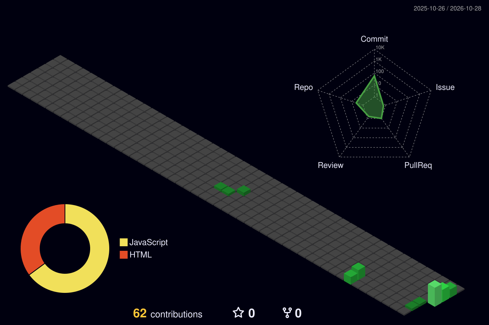

<div align="center">



<a href="https://shamith-s-poojari.github.io">
  
</a>

<br>

<a href="https://www.linkedin.com/in/shamith-s-poojari"></a>
<a href="mailto:shamithgoogl@gmail.com"></a>
<a href="https://shamith-s-poojari.github.io"></a>
<a href="https://shamith-s-poojari.github.io/Shamith-Poojari-Resume.pdf"></a>

</div>

---

## ~/ whoami

```console
$ cat about.txt
```

Hi, I'm **Shamith S Poojari**, a final-year Computer Science student at Mangalore
Institute of Technology and Engineering, specializing in IoT, cybersecurity and
blockchain. Most of what I know came from building things rather than from
lectures, and the parts I care about are the ones that are easy to skip: access
control, error states, and what a system does when the network drops halfway
through a write.

- Currently building **Chain of Custody**, a tamper-evident evidence locker on Ethereum and IPFS
- Portfolio: [shamith-s-poojari.github.io](https://shamith-s-poojari.github.io)
- Based in Moodbidri, Karnataka · graduating 2027
- Open to software engineering internships and full-time roles

---

## ~/ projects

```console
$ ls -l ./projects
```

**[Merkle Seal](https://github.com/shamith-s-poojari/merkle-seal)** · [try it](https://shamith-s-poojari.github.io/merkle-seal/)<br>
Seals a set of files under one Merkle root, then tells you which specific file
changed. Domain-separated hashing, inclusion proofs per file, and it runs entirely
in the browser, so nothing is uploaded.<br>
`Web Crypto` `SHA-256` `JavaScript`

**Chain of Custody: Digital Forensic Locker** · final year project, in progress<br>
Files are hashed with SHA-256 and stored on IPFS, with only the content identifier
anchored to a Solidity contract, keeping gas cost over 90% below writing payloads
on chain. An append-only audit trail makes provenance a three-second contract query.<br>
`Solidity` `Ethereum` `IPFS` `Web3.js` `React` `Node.js`

**Onboarding Management System** · Ankyah Nexus internship, Jan to Apr 2026<br>
Took cohort onboarding from about three hours to under 45 minutes across 120+
candidates. I owned the document module: 300+ secure uploads across three roles,
with 40% fewer data-entry errors from client and server validation.<br>
`React` `Node.js` `MySQL` `REST`

---

<div align="center">

## ~/ toolbox


<br>


---

## ~/ skill radar



---

## ~/ contribution calendar



</div>
